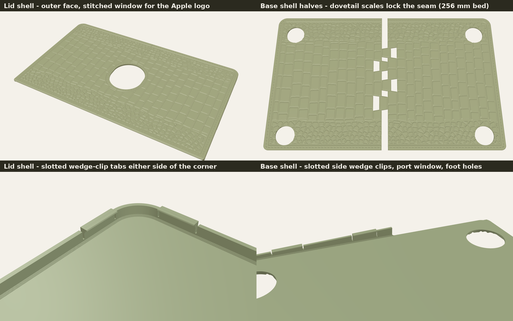
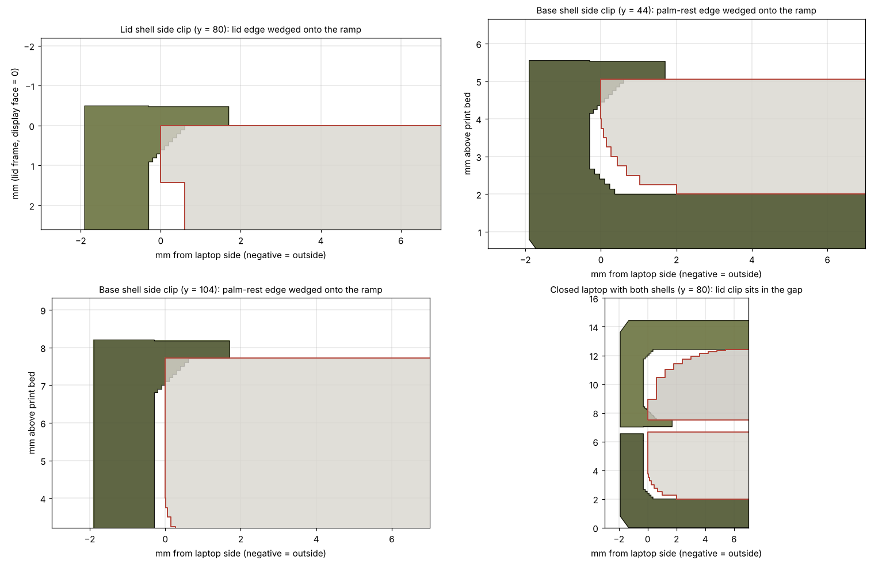
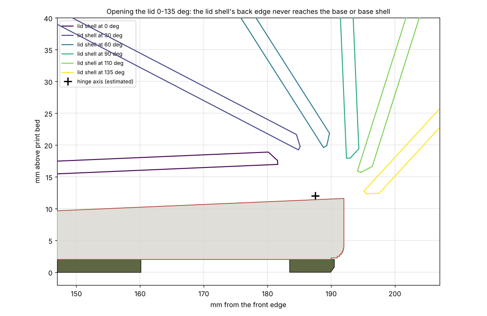
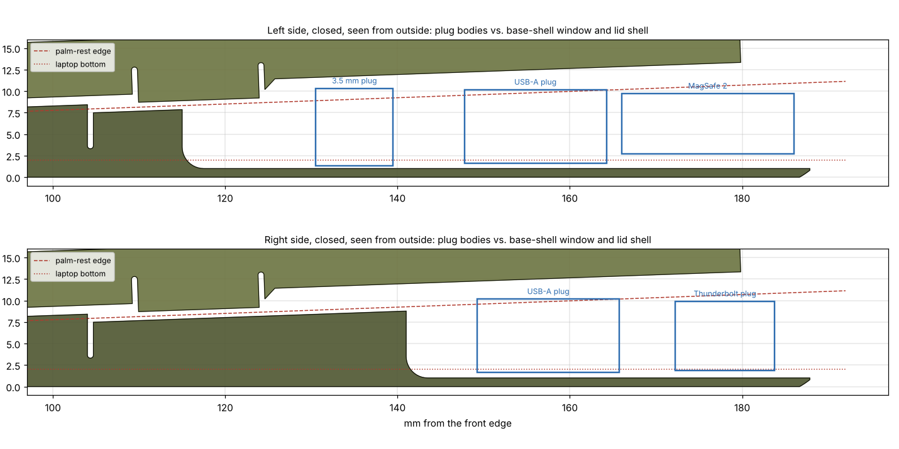

# Alligator-skin TPU case for MacBook Air 11" (A1465)

A two-piece snap-on case for the 11-inch MacBook Air, model **A1465**
(Mid 2012, 2013, Early 2014, Early 2015). The A1370 (2010–2011) has the same
chassis, so the case fits it too. It is designed to print in **TPU** on a
Bambu Lab printer, **once, with no fit tests**: one lid shell and one base
shell, sized to the best estimate of every dimension.



* **Lid shell** clips onto the back of the screen. A stitched, framed
  window in the middle lets the Apple logo show (and glow) through.
* **Base shell** clips onto the bottom. It has an open window over the
  MagSafe 2, USB 3, headphone and mic ports on the left, another over the
  Thunderbolt and USB 3 ports on the right, holes for the four rubber feet,
  and a finger notch at the front so you can still open the lid.
* **Outside:** a belly-cut alligator hide. Big, rounded rectangular scales
  run through the middle, and smaller polygonal flank scales sit near the
  front and back edges. Around it is a smooth border with an embossed
  stitch line, like a stitched leather panel.
* The texture is on the face that prints against the bed. The scale tops
  pick up the plate's surface finish (textured PEI gives a matte, leathery
  grain). No supports are needed anywhere.
* **Clips:** each clip is a *wedge clip*, a short tab with a relief slot on
  each side so it can flex on its own. It has a 0.36 mm lip that reaches
  1.15 mm over the screen bezel or palm rest, with a 1.65 mm tall, 57° ramp
  under it. The laptop's edge wedges onto that ramp anywhere across about
  1 mm of height while the tab flexes outwards. So the clip grips snugly
  even if the real laptop is a few tenths of a millimetre thicker or
  thinner than my estimate. That range is what makes a blind print work.
* **Closing:** the lid clips and base clips are staggered along the sides,
  so only one thin lip sits in the lid/keyboard gap at any point. The plain
  walls stop 0.6 mm short of the clip height, and the base's front wall
  drops to 0.8 mm at the rounded front edge. Behind the rear lid clips,
  the lid shell's side walls step up another 1.2 mm so fat headphone and
  USB plugs clear them when the laptop is closed.
* **Backtested before printing** against a 3D model of the A1465 for fit,
  closing, hinge swing (with cables plugged in), rubber feet and port
  plugs, using the exact print files. A tolerance analysis covers every
  dimension I'm unsure of. See [Fit backtest](#fit-backtest).

## Which files to print

There is no Bambu "T1S". These files assume a **256 × 256 mm** bed
(P1S, P2S, X1C, A1). That bed is too small for a 303 mm case, so each shell
is split into **LEFT** and **RIGHT** halves. The split runs along the
scale grooves, and four dovetail-shaped scales lock the halves together.

| File (in `3mf/`) | What | TPU |
|---|---|---|
| `lid_shell_LEFT.3mf` + `lid_shell_RIGHT.3mf` | lid shell, two halves | ~60 g each |
| `base_shell_LEFT.3mf` + `base_shell_RIGHT.3mf` | base shell, two halves (LEFT has the long MagSafe-side port window) | ~62 g each |
| `one_piece_for_big_beds/` | the same two shells in one piece each, for an H2D/H2S | ~121 g / ~124 g |

That's four plates on a 256 mm bed. The 3MF files open directly in Bambu
Studio. Leave every part in its exported orientation, textured face down.
The generator also writes STL copies to `stl/` (not stored in git).

If you downloaded the earlier version with fit tests and size variants,
don't print those files. A re-measurement found the palm rest about 0.6 mm
higher at the clips than my first estimate, so the old base clips would
have sat too low.

### Bambu Studio settings (P1S/X1C/P2S, 0.4 mm nozzle)

| Setting | Value |
|---|---|
| Layer height | **0.12 mm, first layer 0.20 mm.** Please don't change these. The clip lips and clip heights sit exactly on this layer grid, so another layer height would shift every clip by up to half a layer. |
| Filament feed | **External spool holder.** The AMS can't feed ordinary TPU; only Bambu's "TPU for AMS" is AMS-compatible. |
| Filament profile | Bambu TPU 95A HF (or Generic TPU 95A). Dry the spool first: 4–6 h at 65–70 °C. |
| Plate | Textured PEI (leather grain); bed 35–40 °C |
| Wall loops | 4 |
| Infill | 100 % (the parts are thin, so it is almost all walls and solid layers anyway) |
| Supports | **Off.** Lips, ramps and grooves are designed to print without them. |
| Brim | Off (TPU doesn't warp) |
| Speed | Use the filament profile's limits. Slow the outer wall and overhangs to about 30 mm/s if the clip lips look droopy. |
| Scale | Leave XY scale at 100 %; TPU shrink is already allowed for. |
| Optional | Fuzzy skin → **Contour**, thickness 0.15, point distance 0.4, for a pebbled leather grain on the outside walls (it leaves the inside fit alone) |

Bambu Studio will give the real time estimate. Very roughly, expect 3–4 h
per half at 0.12 mm with TPU 95A HF, and longer with ordinary TPU.

Colour ideas: black, dark brown or deep olive TPU looks most like real
gator. To make the scales pop, wipe a little darker shoe or leather dye into
the grooves and wipe the scale tops clean.

### Logo window

The window is a rounded oval 50 mm wide and 58 mm tall, centred side to
side. It runs from **64 mm to 122 mm back from the lid's front edge** (the
edge opposite the hinge). The logo measured from a photo is about 35 mm
wide and 43 mm tall, centred about 92 mm back, so there are about 6 mm of
margin all round. To check before printing, lay a ruler on the closed lid
from the front edge: the top of the leaf and the bottom of the apple should
both fall between 64 and 122 mm.

The lid shell also stops about 10 mm short of the hinge on purpose, so the
screen can open fully; a strip of aluminium shows there.

## Join the halves

1. Lay both halves textured face down on a flat surface. Push the dovetail
   scales together so the seam closes (the lid has one dovetail above and
   one below the logo window). It sits in the bottom of a groove,
   so it mostly disappears.
2. Glue from the **inside** of the case with flexible CA gel (Loctite Super
   Glue Gel Control or similar) or a flexible adhesive such as E6000. Or
   melt the seam together from the inside with a soldering iron at about
   230 °C and a short piece of the same TPU.
3. Let it cure fully before you fit it.

## Fit it

* **Lid shell:** hook both front corners over the lid first, then press
  down along the sides until the side clips click over the bezel. The
  hinge end is left open on purpose so the screen still opens fully.
* **Base shell:** set the laptop in front edge first, then press the sides
  down until the clips catch the palm-rest edge. The feet sit in their
  holes.
* To take it off, peel one side clip outwards first.

### If it isn't right

The odds are good (see below), but here's what to do if a shell comes out
off. Re-printing only the shell that's wrong is enough.

| What you notice | Likely cause | Fix |
|---|---|---|
| Lid clips won't snap over the bezel, or the lid shell bows | lid thicker than 5.0 mm | regenerate with `--lid-t 5.25`, or tell me |
| Lid shell rattles when you tap the back of the lid | lid thinner than estimated | `--lid-t 4.80` |
| Base clips won't catch the palm rest | palm rest higher than estimated | `--base-offset 0.25` |
| Base rattles at the clips | palm rest lower than estimated | `--base-offset -0.25` |
| Laptop doesn't close fully at the front | a lip is sitting on the gap | shave that clip's lip thinner with a hobby knife, then tell me which one |

If you have calipers, two readings would remove most of the remaining
risk before you print:

* the palm-rest height on the left side, 44 mm back from the front edge
  (bottom case to the top of the palm rest, not on a rubber foot);
* the lid thickness, about 15 mm in from the left edge.

Send them to me and I'll re-centre the clips on them.

## Fit backtest

`fit_backtest.py` builds a 3D stand-in of the A1465:

* a base with rolled bottom edges and rubber feet;
* a palm rest that rises towards the hinge and rounds down at the front;
* the curved lid;
* the lid/keyboard gap, opening slightly towards the front;
* the hinge axis and the port plugs.

It then puts the shells on it and checks them with exact mesh booleans.
Run it yourself with `python3 fit_backtest.py`.

**Geometry checks.** These pass for the nominal laptop and for 14 stress
cases:

* tighter edge rolls, and thin or thick lid edges;
* a laptop 0.4 mm wider or narrower;
* front corner radius ±1.2 mm;
* feet 3 mm off, and ports 5 mm off either way;
* lid 0.3 mm thinner, palm rest 0.4 mm lower, or the lid gap 0.2 mm smaller;
* the front rounding starting 75 mm back.

They also pass for **the exact exported print files**, with the LEFT/RIGHT
halves re-assembled including their seam gap, and for the one-piece files.

* Nothing pushes into the laptop except the 14 lid and 4 base clip wedges.
* Both shells on and the laptop closed: no collisions.
* Lid opened 0→135° with the hinge axis anywhere within ±1.5 mm of the
  estimate and cables plugged in: the lid shell never touches the base,
  the base shell or a plug.
* All four rubber feet sit inside their Ø25 mm holes. Every plug body
  (MagSafe 2, USB-A, Thunderbolt, and a bulky 9 mm headphone plug) clears
  the base shell's port windows and, with the laptop closed, sits at
  least 0.85 mm below the lid shell (1.3 mm nominal).





**Tolerance analysis** (`blind_fit.py`). 200,000 simulated laptops. Every
uncertain dimension is varied by its estimated uncertainty:

* lid thickness and palm-rest height at both clip positions (correlated);
* where the front rounding starts, and the lid/keyboard gap;
* width, corner radius and edge radius;
* foot positions;
* TPU shrink, printer Z error and layer rounding.

Each simulated laptop is weighted by how well it matches Apple's published
back thickness (0.68 in, 17.3 mm, including the feet). Clip limits come
from a finite-element model of the TPU 95A tabs.

| | Snug fit | Usable (a bit tight or loose) |
|---|---|---|
| **Whole case, this print** | **74.7 %** | **93.4 %** |
| Lid clips | 92.2 % | 98.7 % |
| Base clips | 88.2 % | 98.3 % |
| Laptop closes fully with both shells on | 90.5 % | 96.3 % |
| Rubber feet in their holes | 99.8 % | 99.8 % |

"Snug" means every clip either wedges onto its ramp with 0.2–1.8 mm of tab
flex and no free play, or is preloaded by at most 0.45 mm. The clips must
also snap on without over-straining, the laptop must close (propped open
by at most 0.3 mm at the front edge), and the feet must land in their
holes. "Usable" allows up to 0.3 mm of free play, 0.7 mm of preload, or a
0.6 mm prop at the front.

**Where the risk is.** The odds above assume my estimates are centred
correctly. Shifting one estimate by a full standard deviation shows what
matters most:

| Estimate off by 1 sd | Snug | Usable |
|---|---|---|
| Palm-rest height at the front clips (±0.40 mm) | 49–54 % | 76–82 % |
| Lid thickness (±0.35 mm) | 59–70 % | 87–88 % |
| Palm-rest height at the rear clips (±0.35 mm) | 62–65 % | 88 % |
| Lid/keyboard gap (±0.10 mm) | 70–78 % | 91–95 % |
| Front corner radius, laptop edge radius | no change | no change |

The palm-rest height near the front is the one number a photo can't pin
down well, which is why it's the caliper reading worth taking if you can.

`fit_backtest_results.json` has every number.

## Measurements used

| Feature | Value | Source |
|---|---|---|
| Width × depth | 299.5 × 192.0 mm | Apple tech specs (29.95 × 19.2 cm) |
| Closed thickness | 0.11 in front, 0.68 in back incl. feet | Apple; 17.8 mm measured by a stand designer |
| Front corner radius | 10 mm | measured from a rectified photo of the bottom case |
| Rubber feet | Ø 18 mm, 2.0 mm proud; centres 24.4 mm from the sides, 26.0 mm from the front, 20.2 mm from the back | positions from the photo (it measures Ø18.1 vs 18 published, a 0.6 % check); Ø and height from an A1465 replacement-foot design |
| Palm-rest (deck) height above the bottom case | 3.72 ± 0.39 mm at 44 mm from the front, 5.91 ± 0.32 mm at 104 mm; rounds down over the front ~43 mm | camera-model fit of the side photo (lens, tilt and scale fitted to the USB-A and 3.5 mm jack openings), checked against Apple's back thickness |
| Lid thickness | 5.0 ± 0.3 mm | not published by Apple; derived and checked against the 17.3 mm back thickness |
| Lid/keyboard gap | 0.87 mm at the back, ~1.1 mm at the front | side photo + published thicknesses |
| Ports (from back edge) | L: MagSafe 2 ~7–25, USB ~29–43, headphone ~57, mics ~71 · R: Thunderbolt ~9–19, USB ~27–42 | side photos |

**Case design** (all in `generate_case.py`):
* 0.45 mm clearance per side (it includes 0.1 mm for the seam gap that
  closes when the halves are glued);
* 1.6 mm walls, and a 2.0 mm floor including the 0.75 mm-deep grooves;
* **lid clips** with the lip underside 5.04 mm above the floor:
  * two at each front corner, on the straight runs either side of it, so
    the exact corner radius doesn't matter;
  * one in the middle of each half of the front edge;
  * two per side, at 62–82 and 110–124 mm from the front;
* **base clips** at 38–56 and 88–104 mm from the front on each side. The
  lip underside is 3.91 mm above the floor at 44 mm and 6.05 mm at 104 mm;
* 0.7 mm relief slots either side of every clip;
* a 50 × 58 mm logo window in the lid shell, centred 93 mm from the lid's
  front edge, with a 0.6 mm chamfer and a stitched frame (`logo_window` in
  `generate_case.py`; set it to `None` for a closed lid shell).

## Changing the design

`generate_case.py` rebuilds everything in about a minute.
`fit_backtest.py` re-runs every check and the tolerance analysis in about
two minutes.

```bash
pip install -r requirements.txt
python3 generate_case.py                     # rebuild all files
python3 generate_case.py --lid-t 5.25        # lid clips higher (thicker lid)
python3 generate_case.py --base-offset 0.25  # raise the base clips 0.25 mm
python3 generate_case.py --clear 0.55        # looser side fit
python3 fit_backtest.py                      # virtual fit + tolerance analysis
python3 blind_fit.py                         # tolerance analysis only
```

You can change everything else at the top of `generate_case.py`: clip
positions and profile, groove depth, scale size, stitching and port window
positions. If you'd rather not run Python, send me a caliper reading and
I'll regenerate the files.

Every exported part was checked to be watertight and manifold after
vertex merging, with consistent normals, so Bambu Studio shouldn't report
any mesh errors.

### Sources

* [Apple: MacBook Air (11-inch) tech specs](https://support.apple.com/en-us/112580)
* [iFixit: MacBook Air 11" Early 2014](https://ts.ifixit.com/Device/MacBook_Air_11%22_Early_2014)
* [Notebookcheck: MacBook Air 11 Early 2015 review](https://www.notebookcheck.net/Apple-MacBook-Air-11-Early-2015-Notebook-Review.141993.0.html)
* [Wikimedia Commons: MacBook Air 11 inch side view](https://commons.wikimedia.org/wiki/File:MacBook_Air_11_inch_side_view.jpg)
* [Beetstech: A1465 bottom case 923-0436 (photo)](https://beetstech.com/product/macbook-air-11-inch-a1465-bottom-case-923-0436)
* [LaptopMag: MacBook Air 11 (2015) review (port photos)](https://www.laptopmag.com/reviews/laptops/macbook-air-11-2015)
* [Printables: MacBook Air feet for A1465 (Ø18 mm, 2 mm)](https://www.printables.com/model/905180)
* [MyMiniFactory: MacBook Air 11" (2013) vertical stand, 17.8 mm thickness](https://www.myminifactory.com/object/3d-print-141070)
* [Bambu Lab printer build volumes](https://blog.printpal.io/which-bambu-lab-printer-is-right-for-you-a-2026-buyers-guide/)
